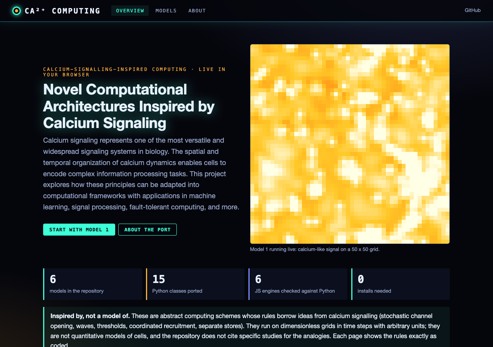
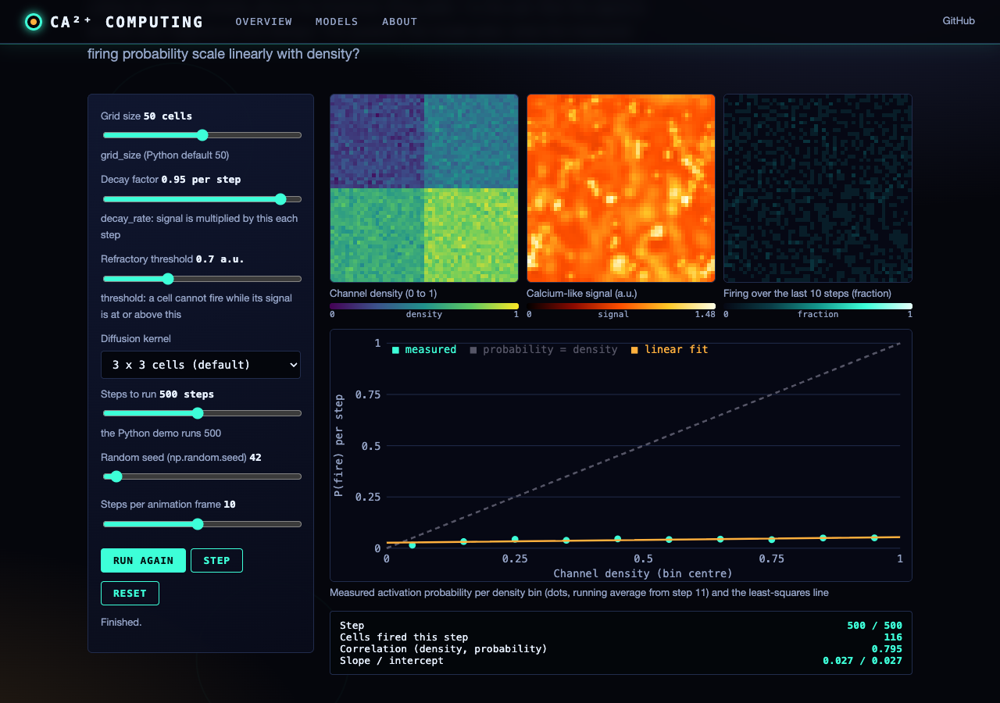
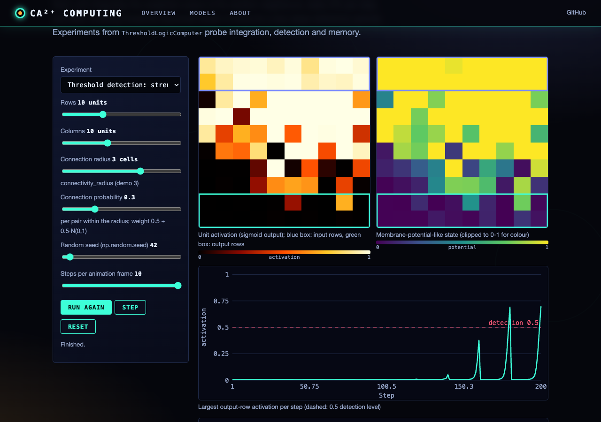
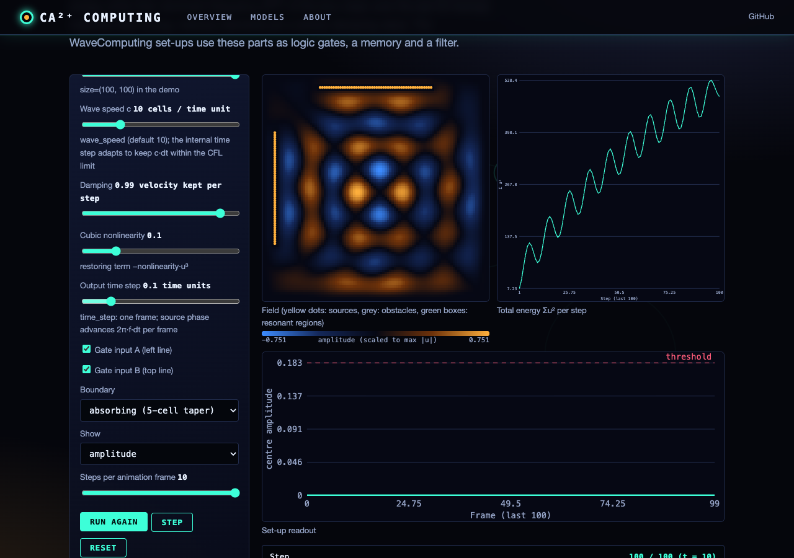

# CalciumComputing

## Novel Computational Architectures Inspired by Calcium Signaling

This repository contains a collection of computational models inspired by calcium signaling dynamics in biological systems. These models demonstrate how principles from cellular calcium dynamics can inform novel computing paradigms with unique capabilities beyond traditional computing approaches.

## Overview

Calcium signaling represents one of the most versatile and widespread signaling systems in biology. The spatial and temporal organization of calcium dynamics enables cells to encode complex information processing tasks. This project explores how these principles can be adapted into computational frameworks with applications in machine learning, signal processing, fault-tolerant computing, and more.

## Models

### 1. Probabilistic Computing Based on Calcium Puff Dynamics

This model asks whether the probability of signal activation scales with the density of processing elements, as calcium puff probability does with IP3R cluster size. Each grid site fires with probability equal to its "channel density" unless its signal is still above a refractory threshold; firing adds signal, which spreads to neighbours and decays.

Measured response: activation probability rises with density, but because the refractory threshold blocks most sites at the default decay rate (0.95), it stays at a few percent per step (about 0.02 to 0.05 across densities 0.05 to 0.95; fitted slope about 0.02 to 0.03, correlation about 0.8, seeds 42, 1 and 2, 500 steps). With faster decay (decay_rate=0.5) the response is close to linear (slope about 0.7, correlation 0.98).

**Key Features:**
- Stochastic computing with predictable probabilities (bitstream multiply, add, subtract, divide)
- Activation probability that increases with element density (near-linear only with fast signal decay)
- Implementation of probabilistic logic operations

```bash
python probabilistic_computing/probabilistic_computing.py
```

### 2. Spatiotemporal Computing Inspired by Calcium Wave Propagation

This model implements a reaction-diffusion system where information is encoded in wave patterns and processing occurs through their spatiotemporal evolution.

**Key Features:**
- Multiple channels with different diffusion constraints
- Pattern recognition through spatiotemporal dynamics
- Information encoding in spatial configurations

```bash
python spatiotemporal_computing/spatiotemporal_computing.py
```

### 3. Analog Computing with Calcium-Like Thresholds

This model creates threshold logic units with calcium-like activation properties, demonstrating how computation can emerge from threshold-based dynamics.

**Key Features:**
- Temporal integration of weak signals
- Threshold-based decision making
- Analog memory capability

```bash
python threshold_computing/threshold_computing.py
```

### 4. Coordinated Recruitment Computing

This model demonstrates quorum sensing-like computation where elements remain dormant until enough neighboring elements are activated, similar to coordinated calcium channel opening.

**Key Features:**
- Self-organizing functional groups
- Fault tolerance through redundancy
- Signal amplification through recruitment

```bash
python coordinated_recruitment/coordinated_recruitment.py
```

### 5. Multi-Store Hybrid Computing Architecture

This model implements a hierarchical memory system with different store types inspired by distinct calcium stores (ER, lysosomes, etc.) in cells.

**Key Features:**
- Specialized stores for different types of computation
- Cross-store communication
- Hybrid analog-digital processing

```bash
python multistore_computing/multistore_computing.py
```

### 6. Wave-Based Processing

This model demonstrates how information can be encoded in wave properties (amplitude, frequency, phase) and computation can emerge through wave interactions.

**Key Features:**
- Pattern recognition through wave dynamics
- Logic gates (AND, OR, XOR) via wave interference: each input switches a line of sources, the output is the wave amplitude where the waves meet
- Signal filtering through resonant wave interactions
- Information storage in persistent wave patterns

```bash
python wave_based_computing/wave_based_computing.py
```

## Web interface

All six models also run in the browser: https://gddickinson.github.io/calcium_signalling_inspired_computing/
(published by `.github/workflows/pages.yml` from `main` once GitHub Pages is set to "GitHub Actions").
Each model page runs a JavaScript port of the Python classes (`web/static/*_engine.js`) with live
visualisations and parameter controls; a seed replays the seeded Python run number for number, because the ports
use a JavaScript copy of numpy's legacy random generator. An overview page explains the idea in this README's words.






### Run the web app

```bash
pip install -r requirements-web.txt
python run_web.py                  # http://127.0.0.1:8144 (local only)
python scripts/build_static.py     # static GitHub Pages site in site/
python -m pytest -q tests          # model tests, regression tests, web tests (needs node for the JS checks)
```

The JS engines are checked against the Python by `node web/static/<engine>.test.mjs`, using reference runs in
`tests/fixtures/` written by `python scripts/make_<name>_fixture.py --write`; `tests/test_web.py` checks the
fixtures still match the current Python. The spatiotemporal pattern recognition (scikit-learn) is shown from a
Python run made when the site is built.

## Installation

```bash
# Clone this repository
git clone https://github.com/gddickinson/calcium_signalling_inspired_computing.git

# Navigate to the repository directory
cd calcium_signalling_inspired_computing

# Create and activate a virtual environment (optional but recommended)
python -m venv venv
source venv/bin/activate  # On Windows, use: venv\Scripts\activate

# Install dependencies
pip install -r requirements.txt
```

## Requirements

- Python 3.8+
- NumPy
- SciPy
- Matplotlib
- scikit-learn
- networkx

## Usage Examples

Run these from the repository root (the model folders are importable packages).

### Probabilistic Computing

```python
from probabilistic_computing import CalciumPuffComputing, StochasticComputing

# Initialize the model
model = CalciumPuffComputing(grid_size=50)

# Run simulation
results = model.run_simulation(steps=500)

# Visualize results
model.visualize(results)

# Perform stochastic multiplication
stoch_comp = StochasticComputing(model)
result = stoch_comp.stochastic_multiply(0.3, 0.7)
print(f"0.3 × 0.7 ≈ {result:.4f}")
```

### Wave-Based Computing

```python
from wave_based_computing import WaveComputingMedium, WaveComputing

# Initialize medium
medium = WaveComputingMedium(size=(100, 100))

# Add wave sources
medium.add_source((20, 50), amplitude=0.5, frequency=0.8)
medium.add_source((80, 50), amplitude=0.5, frequency=0.8, phase=np.pi)

# Run simulation
frames = medium.run_simulation(steps=100, visualize=True)

# Initialize wave computer
computer = WaveComputing(medium)

# Filter a signal
signal = np.sin(np.linspace(0, 2*np.pi, 50)) + 0.3*np.sin(5*np.linspace(0, 2*np.pi, 50))
result = computer.wave_filter(signal, filter_type='lowpass', cutoff_frequency=0.3)
```

## Applications

These computational models have potential applications in:

- **Fault-Tolerant Computing**: Systems resilient to component failures
- **Energy-Efficient Computing**: Lower power requirements through analog and stochastic methods
- **Pattern Recognition**: Novel approaches to classification problems
- **Signal Processing**: Filtering and transformation through wave dynamics
- **Hybrid Computing**: Architectures combining digital and analog processing
- **Self-Organizing Systems**: Adaptable computing without explicit programming

## Research Background

This project is inspired by research on calcium signaling dynamics, particularly:

- IP3-mediated calcium puffs and waves
- NAADP-sensitive calcium stores
- Coordinated opening of calcium channels
- Cross-talk between different calcium stores
- Spatial and temporal calcium encoding

## Citation

If you use these models in your research, please cite:

```
@misc{CalciumComputing2023,
  author = {Dickinson, George},
  title = {CalciumComputing: Novel Computational Architectures Inspired by Calcium Signaling},
  year = {2025},
  publisher = {GitHub},
  journal = {GitHub Repository},
  howpublished = {\url{https://github.com/gddickinson/calcium_signalling_inspired_computing}}
}
```

## Contributing

Contributions are welcome! Please feel free to submit a Pull Request.

1. Fork the repository
2. Create your feature branch (`git checkout -b feature/amazing-feature`)
3. Commit your changes (`git commit -m 'Add some amazing feature'`)
4. Push to the branch (`git push origin feature/amazing-feature`)
5. Open a Pull Request

## License

This project is licensed under the MIT License - see the [LICENSE](LICENSE) file for details.

## Acknowledgments

- This work draws inspiration from research on calcium signaling in various cell types
- Special thanks to contributors in the fields of computational neuroscience and biologically-inspired computing


---
*Built with AI assistance from [Claude (Anthropic)](https://claude.com/).*
